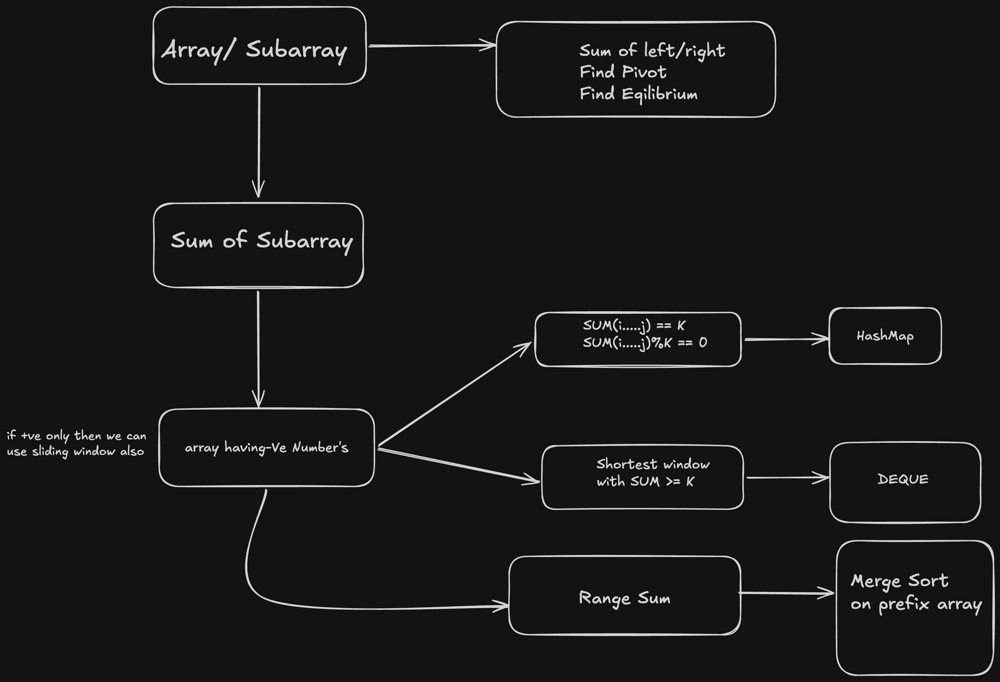

# Prefix Sum Pattern

### Pattern Detection
* **Sign 1:** Question involves linear data structures like an **Array** and operates on continuous **Subarrays**.
* **Sign 2:** Works with arrays containing **positive AND negative numbers** (where Sliding Window fails).
* **Sign 3:** Asks for exact target sum conditions (e.g., `sum == K`, `sum % K == 0`), or range sum queries.
* **Sign 4:** Differs from Kadane's Algorithm (which focuses on global `max`/`min` continuous sums or products).

---

### TL;DR
- **Core Logic:** A subarray sum between indices `L` and `R` can be represented as `prefix_sum[R] - prefix_sum[L-1]`.
- **The Red/Green Framework:** 
  - **Total Sum till `i`:** `curr_sum`
  - **Green Part (Target Subarray):** Matches the desired constraint (e.g., `sum = K`).
  - **Red Part (Prefix to Remove):** `red_sum = curr_sum - K`.
  - **Strategy:** Store frequency of past `red_sum` values in a HashMap to count valid green subarrays ending at `i`.
- **Time Complexity:** $O(N)$
- **Space Complexity:** $O(N)$ (using a HashMap/Frequency Map)

---



---

### Pseudo Codes

#### 1. Range / Pivot Index Calculation (Naive vs. Optimized)

```text
# Pivot Index Concept: left_sum == right_sum at index i
total_sum = sum(arr)
left = 0

for i in range(len(arr)):
    right = total_sum - arr[i] - left
    
    if left == right:
        return i  # Pivot found
        
    left += arr[i]

return -1
```

#### 2. Subarray Sum Equals K (Frequency Map Template)

```text
curr_sum = 0
map = {0: 1}  # Base case: empty prefix sum has sum 0 occurring once
count = 0

for i in range(len(arr)):
    curr_sum += arr[i]
    diff = curr_sum - k  # The "Red Part" to find
    
    if diff in map:
        count += map[diff]
        
    map[curr_sum] = map.get(curr_sum, 0) + 1

return count
```

> **Note:** For `sum % K == 0` variants, store remainders `(curr_sum % K + K) % K` in the map instead of raw sums.

---

### Top 10 Practice LeetCode Problems

Here are classic LeetCode problems covering standard Prefix Sum patterns and HashMap variants:

| # | Problem | Difficulty | Variation Type | Key Strategy |
|---|---|---|---|---|
| 1 | [560. Subarray Sum Equals K](https://leetcode.com/problems/subarray-sum-equals-k/) | **Medium** | **Exact Sum K** | Standard Prefix Sum + HashMap template tracking `curr_sum - K`. |
| 2 | [974. Subarray Sums Divisible by K](https://leetcode.com/problems/subarray-sums-divisible-by-k/) | **Medium** | **Remainder / Modulo** | Track remainder frequency: `rem = (curr_sum % K + K) % K` in map. |
| 3 | [525. Contiguous Array](https://leetcode.com/problems/contiguous-array/) | **Medium** | **Equal 0s and 1s** | Treat `0` as `-1`. Find longest subarray with `sum == 0` using map to store first index of each prefix sum. |
| 4 | [523. Continuous Subarray Sum](https://leetcode.com/problems/continuous-subarray-sum/) | **Medium** | **Remainder + Min Length** | Track `curr_sum % K` indices. Ensure subarray length is $\ge 2$. |
| 5 | [724. Find Pivot Index](https://leetcode.com/problems/find-pivot-index/) | **Easy** | **Pivot / Balance** | Compare `left_sum` with `total_sum - arr[i] - left_sum`. |
| 6 | [238. Product of Array Except Self](https://leetcode.com/problems/product-of-array-except-self/) | **Medium** | **Prefix & Suffix** | Combine prefix products and suffix products without using division. |
| 7 | [304. Range Sum Query 2D - Immutable](https://leetcode.com/problems/range-sum-query-2d-immutable/) | **Medium** | **2D Prefix Sum** | Build 2D prefix matrix using 2D inclusion-exclusion principle. |
| 8 | [1248. Count Number of Nice Subarrays](https://leetcode.com/problems/count-number-of-nice-subarrays/) | **Medium** | **Parity Mapping** | Map odd numbers to `1` and even numbers to `0`. Reduces to Subarray Sum Equals $K$. |
| 9 | [1590. Make Sum Divisible by P](https://leetcode.com/problems/make-sum-divisible-by-p/) | **Medium** | **Min Subarray Removal** | Find shortest subarray with `sum % P == total_sum % P` using HashMap. |
| 10 | [862. Shortest Subarray with Sum at Least K](https://leetcode.com/problems/shortest-subarray-with-sum-at-least-k/) | **Hard** | **Prefix Sum + Monotonic Queue** | Combines Prefix Sum with Monotonic Deque to handle negative numbers with inequality conditions ($\ge K$). |